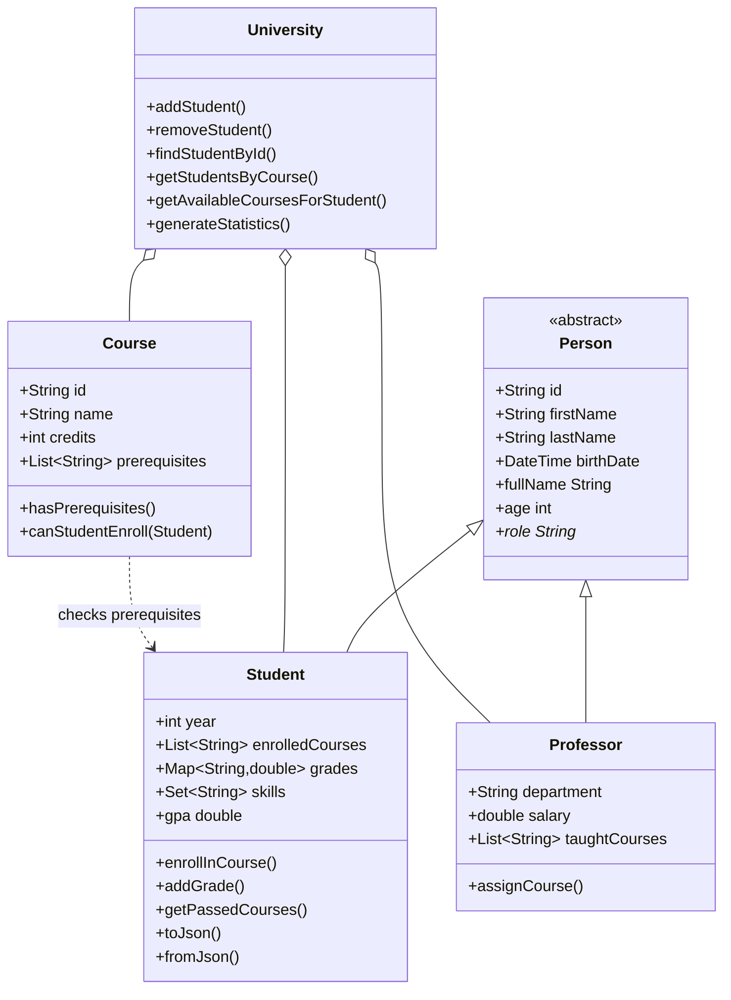

# dart-basics-menshov

Практична робота 4 - **Основи мови Dart** (дисципліна «Програмування для мобільних платформ»).
Консольні програми на Dart та система управління університетом (University Management System).

## Вимоги

- Dart SDK **3.0.0** або новіша версія
- Git

## Встановлення Dart SDK

- Windows: `choco install dart-sdk` або інсталятор з <https://dart.dev/get-dart>
- macOS: `brew tap dart-lang/dart && brew install dart`
- Linux: інструкція на <https://dart.dev/get-dart>

Перевірка: `dart --version`

## Запуск

```bash
dart pub get

dart run bin/task1_variables.dart   # змінні та типи даних
dart run bin/task2_functions.dart   # функції, калькулятор, аналізатор тексту
dart run bin/task3_classes.dart     # ООП: University Management System
dart run bin/task4_collections.dart # колекції, обробка CSV, звіти
dart run bin/task5_async.dart       # async/await, Stream, файли
```

Якість коду:

```bash
dart format .
dart analyze
dart test
# покриття
dart pub global activate coverage
dart test --coverage=coverage
dart pub global run coverage:format_coverage --lcov --in=coverage --out=coverage/lcov.info --report-on=lib
```

Документація API: `dart doc .` (результат у `doc/api`).

## Структура

```
bin/   task1..task5 - демонстраційні програми
lib/
  models/  person.dart, student.dart, course.dart, university.dart
  utils/   calculator.dart, data_processor.dart
test/  models_test.dart, utils_test.dart
data/  students.csv (sample data); data/output/ - згенеровані звіти
```

## Завдання

| # | Файл | Що демонструє |
|---|------|---------------|
| 1 | `bin/task1_variables.dart` | int/double/num, String, bool, List/Set/Map, null safety, `late` |
| 2 | `bin/task2_functions.dart` | параметри (optional/named), closures, map/where/fold, рекурсія, калькулятор, текстовий аналізатор |
| 3 | `bin/task3_classes.dart` | наслідування, поліморфізм, інкапсуляція, CRUD, JSON |
| 4 | `bin/task4_collections.dart` | обробка CSV, групування, множини, звіти |
| 5 | `bin/task5_async.dart` | Future, `Future.wait`, timeout, Stream, файловий I/O |

## Приклад використання класів

```dart
final uni = University(name: 'Lviv Polytechnic');
final s = Student(id: 'S001', firstName: 'Olena', lastName: 'Kovalenko',
    birthDate: DateTime(2004, 3, 15), year: 2);
uni.addStudent(s);
s.enrollInCourse('CS101');
s.addGrade('CS101', 91);
print(s.gpa); // 91.0
print(uni.generateStatistics());
```

## UML



## Декларація використання ШІ

> ЗАПОВНІТЬ ЦЕЙ РОЗДІЛ ПРАВДИВО перед здачею.

- **Інструмент ШІ:** Claude (Anthropic)
- **Мета використання:** _(напр., генерація початкового каркаса проєкту та прикладів коду)_
- **Текстовий запит (промпт):** _(вставте свій реальний промпт)_
- **Які фрагменти увійшли до роботи:** _(перелічіть файли/функції)_
- **Власне доопрацювання:** _(що ви перевірили, запустили, змінили самостійно)_
